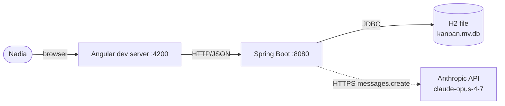
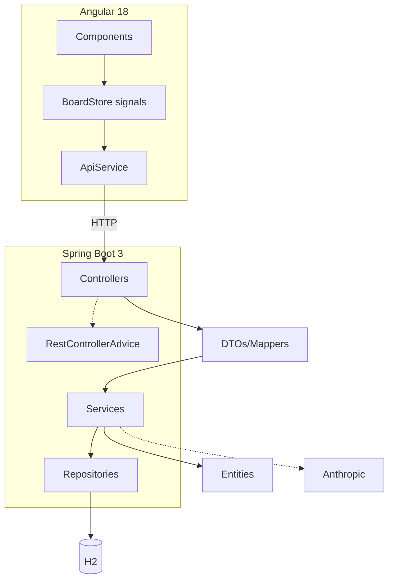
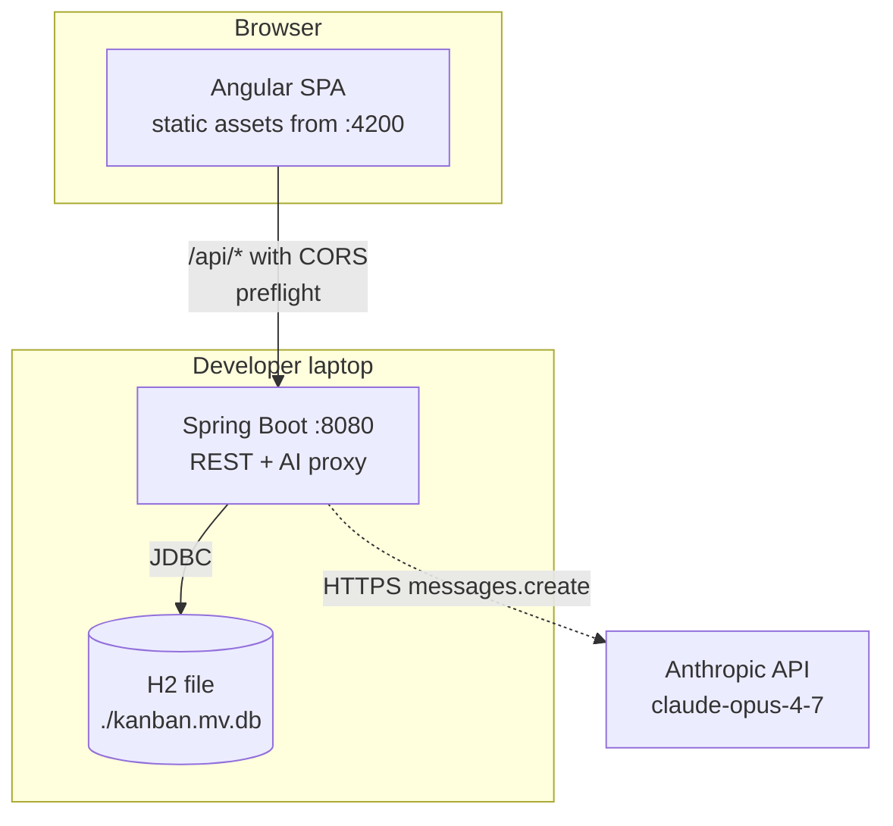
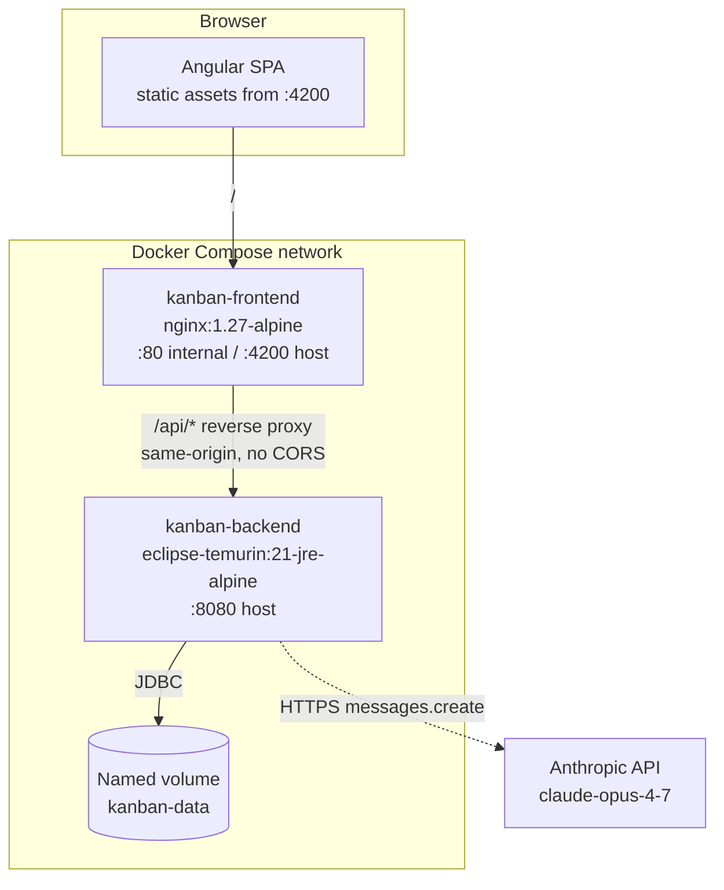
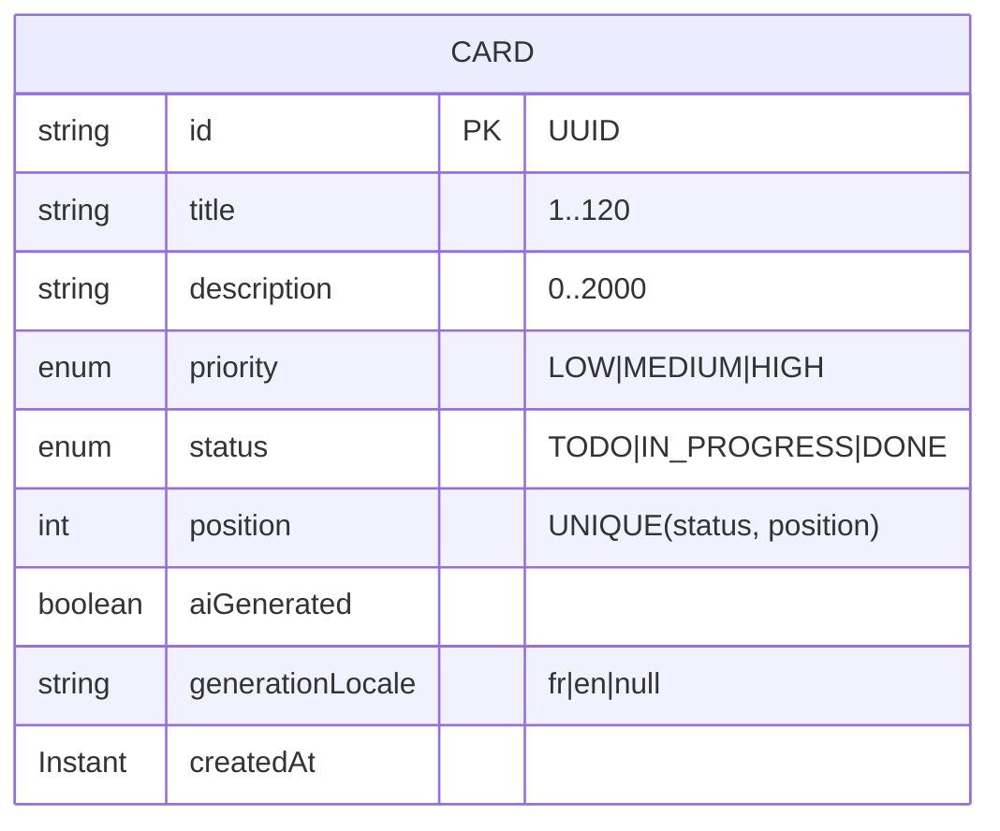
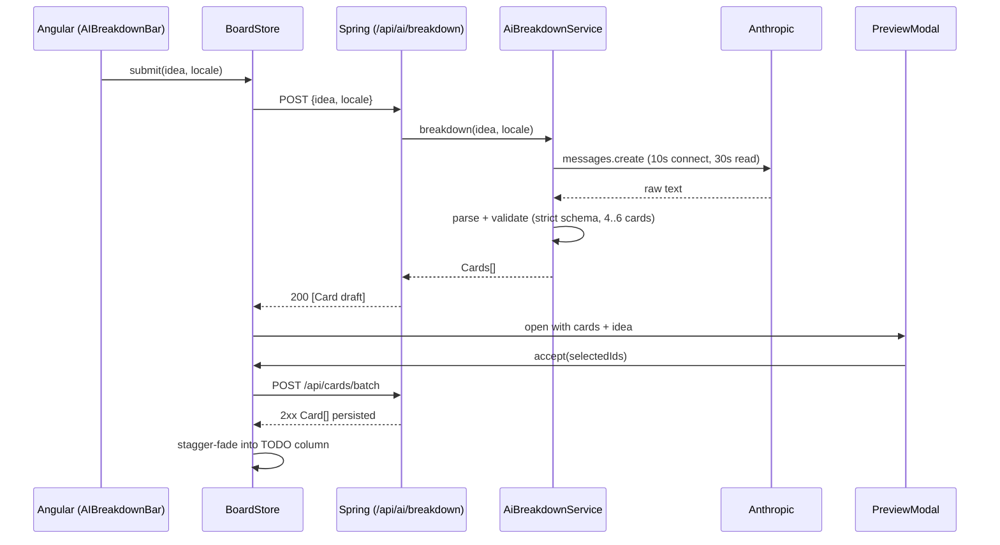

# Architecture Spine — Local AI-Augmented Kanban

## Design Paradigm

**Backend: classic layered Spring MVC.** `controller → service → repository`, with `dto`/`mapper` straddling the controller boundary. One `@RestControllerAdvice` owns error translation. One service method owns one transaction.

**Frontend: standalone-component signal-reactive Angular.** `BoardStore` service holds board state as writable signals; components read via `computed()` / `effect()` and dispatch mutations as method calls on the store. `ApiService` is the only HTTP surface; the store talks to it, components never do.

**System shape: two independently-runnable local processes** talking HTTP/JSON across `localhost:8080` ↔ `localhost:4200`. The only outbound dependency is `api.anthropic.com` for the single AI breakdown call.



## Invariants & Rules



Dotted = exception/non-mainline path. **Entities never cross the `svc` box.** Controllers never touch repositories or entities. Components never touch `ApiService`.

### AD-1 — Dependency direction is layered and one-way `[ADOPTED]`

- **Binds:** all backend code; FR-1..FR-27, NFR-8
- **Prevents:** controllers depending on JPA repositories or entities; services depending on peer services; lazy-init exceptions crossing the HTTP boundary
- **Rule:** `controller` depends only on `service` interfaces and `dto`; `service` depends on `repository` and `mapper`; `repository` depends on nothing in-app; `mapper` translates `dto ↔ entity` and is called only from services. Entities **never** appear in a controller signature.

### AD-2 — Single error envelope, single handler

- **Binds:** every `/api/**` endpoint; FR-26 and all failure cases
- **Prevents:** per-endpoint drift in error shape; frontend toast mapping fragmenting across call sites; silent failures when an endpoint returns something the toast layer doesn't recognize
- **Rule:**
  - Error body shape is always `{ error: <UPPER_SNAKE>, message: <string> }`. One `@RestControllerAdvice` bean translates: `AiUnavailableException → 503 AI_UNAVAILABLE`, bean-validation failures / malformed JSON → `400 VALIDATION_FAILED`, `EntityNotFoundException → 404 NOT_FOUND`, everything else → `500 INTERNAL_ERROR` with a generic message. `message` is localized when the `Accept-Language` header is `fr`, otherwise EN.
  - `503 AI_UNAVAILABLE` is reserved for failures **after** an Anthropic call has started (network, non-2xx upstream, schema violation). Pre-call input errors on `/api/ai/breakdown` are `400 VALIDATION_FAILED`, same as any other endpoint.
  - The frontend's `Toast` layer maps **by status class**, not by `error` string: on 4xx it shows the `message` field as a validation message; on 503 it shows the "AI unavailable" toast; on any other 5xx it shows a generic "Something went wrong" toast. No non-2xx response is ever silent.

### AD-3 — Enums are server-authoritative `[ADOPTED]`

- **Binds:** `status`, `priority` fields across API + storage + UI; FR-7
- **Prevents:** parallel string tables, int-vs-string drift, a shadow `Column` entity
- **Rule:** `CardStatus` = `{TODO, IN_PROGRESS, DONE}`, `Priority` = `{LOW, MEDIUM, HIGH}`. Both are Java enums; Jackson serializes/deserializes as the UPPER_CASE literal. The frontend declares matching string-union types manually (`type CardStatus = 'TODO' | 'IN_PROGRESS' | 'DONE'`). Column identity is derived from `status` on both sides — there is **no `Column` entity**.

### AD-4 — Position is server-owned, server-renumbered, race-free `[ADOPTED]`

- **Binds:** every card create / move / delete; FR-5, FR-6; addendum schema
- **Prevents:** FE and BE computing different orderings; a "position gaps" bug class; race conditions where two moves overlap and duplicate a `position`
- **Rule:**
  - `position` is a zero-indexed int, unique within each `status`. The database enforces this with a `UNIQUE(status, position)` constraint; a violation is treated as a server bug, not a client error.
  - On any operation that changes membership (`create`, `delete`, `move`), the service acquires a `SELECT … FOR UPDATE` on all cards in the affected status partition(s) at the start of the transaction, renumbers them `0..n−1`, then returns the authoritative list. Concurrent moves serialize at the DB layer rather than racing.
  - Clients may send a desired `position` on `move`; the server treats it as a hint and recomputes.
  - The FE replaces its local list with the response; it does not re-sort client-side.

### AD-5 — AI output is validated in the service, never in the controller or the UI `[ADOPTED]`

- **Binds:** `POST /api/ai/breakdown`; FR-12, FR-29
- **Prevents:** UI code parsing partial or malformed LLM output; a 200 response ever carrying invalid cards
- **Rule:** `AiBreakdownService` calls Anthropic via `RestClient` with `output_config.format = { type: "json_schema", schema: { cards: [{ title, description, priority }], minItems: 4, maxItems: 6 } }` so the model is forced to emit valid JSON. The server then runs a defense-in-depth Jackson validator against the same schema with the full field rules (`title`: non-empty, trimmed, ≤120; `description`: non-empty, trimmed, ≤2000; `priority`: `CardStatus` enum literal) and the count range `4..6`. Any deviation — network failure, non-JSON, schema violation, wrong card count, upstream non-2xx — throws `AiUnavailableException`. Pre-call input validation (idea length, locale) fails fast with `400 VALIDATION_FAILED` **before** the Anthropic call starts. The 503 class is reserved for failures **after** the call starts (per AD-2). Never a 200 with empty cards. Never a partial.

### AD-6 — AI capability is runtime-probed, not compile-time flagged `[ADOPTED]`

- **Binds:** `ANTHROPIC_API_KEY` env var; FR-24, FR-25
- **Prevents:** build-time feature flags; environment drift between machines and frontend assumptions
- **Rule:** `AiBreakdownController`, `AiBreakdownService`, and the Anthropic `RestClient` bean are gated by `@ConditionalOnProperty(name = "anthropic.api-key", matchIfMissing = false)`. When the key is absent the bean graph omits them entirely — `/api/ai/breakdown` returns 404. `GET /api/config` returns `{ aiEnabled: boolean, locales: ["fr","en"] }` and is the **only** signal the frontend reads to decide whether to render `AIBreakdownBar`. The frontend never checks the env var itself and never hard-codes `aiEnabled`.

### AD-7 — `@Transactional` lives on service methods only

- **Binds:** every mutating service method
- **Prevents:** controllers composing transactions, repositories opening their own, lazy-init exceptions bleeding to the controller
- **Rule:** Mutating service methods carry `@Transactional`. Read-only queries carry `@Transactional(readOnly = true)`. Controllers and repositories carry no transaction annotation.

### AD-8 — Optimistic update for direct mutations; non-optimistic, atomic batch for AI accept

- **Binds:** CDK drag-drop, inline-edit title/description, priority chip cycle, delete; batch-accept from `PreviewModal`
- **Prevents:** two incompatible update strategies across card interactions; UI showing cards that failed to persist; partial batch commits that leave the board in an undefined half-accepted state
- **Rule:**
  - **Single-card mutations** (move, edit, priority, delete): `BoardStore` mutates its signal immediately and fires `PATCH`/`DELETE`; on non-2xx or network error it restores the pre-mutation snapshot and emits a `Toast`. A rollback that collides with a newer local mutation keeps the newer value (last-write-wins on identical fields; non-overlapping fields merge).
  - **AI accept** (`POST /api/cards/batch`): the FE sends the **full list of selected cards** as the request body (title, description, priority — no ids, no positions, no `aiGenerated` flag; the server sets id/position/`aiGenerated=true` server-side). The server re-validates every card against the same schema as AD-5 inside one `@Transactional` method.
  - The batch is **atomic all-or-nothing**: either every selected card persists and the server returns `201 Created` with the full persisted array, or the whole batch rolls back and returns `400 VALIDATION_FAILED` (bad input) or `500 INTERNAL_ERROR` (DB failure). No partial success. No `207 Multi-Status`. No server-side queued state between preview and accept.
  - Cards enter the board only on `2xx`; the modal stays open with an inline error on failure; the input idea is retained. Loading is covered by `aria-busy` + the "Thinking…" live region (EXPERIENCE.md `Loading (AI)` state).

### AD-9 — One board store, one HTTP surface

- **Binds:** every Angular component that reads or writes board state
- **Prevents:** half the components doing HTTP themselves while half go through a store
- **Rule:** `BoardStore` service (root-provided) holds `cards: WritableSignal<Card[]>` and exposes `readonly` projections (`todo`, `inProgress`, `done`, `cardCount`) as `computed()`. All mutations go through `BoardStore` methods, which call `ApiService`. `ApiService` is the only class that injects `HttpClient`. Components never inject `HttpClient` or call `ApiService` directly.

### AD-10 — Localization split

- **Binds:** all user-facing text; FR-17..FR-20
- **Prevents:** re-translation bugs on AI content, inconsistent locale handling on mixed content
- **Rule:**
  - **UI chrome** (labels, buttons, placeholders, aria-labels, status-line copy) comes from `ngx-translate` keys in `/i18n/fr.json` + `/i18n/en.json`. Locale switch via `TranslateService.use(locale)` **and** `document.documentElement.lang = locale` (EXPERIENCE.md `LocaleSwitcher`).
  - **AI-generated card content** is stored verbatim in the locale it was generated in. The server reads `locale` from the request body (`/api/ai/breakdown`), passes it into the Claude system prompt, persists the returned text unchanged, and **stores the locale on the entity as `generationLocale`** (immutable; see AD-14). If the user switches locale mid-breakdown, the request-in-flight's `locale` is the one that lands on the persisted cards — never the active UI locale at modal-accept time. Rendered DOM nodes stamp `lang="<generationLocale>"` on title + description when `card.aiGenerated === true`.
  - **User-typed content** (manual card titles/descriptions) is never translated. Stored as the user entered it; no `lang` stamp (browser default applies).

### AD-11 — Test shape `[ADOPTED]`

- **Binds:** backend test tree; NFR-7
- **Prevents:** over-testing the Angular side or under-testing the single highest-risk unit (the AI parser)
- **Rule:** three layers only, no E2E, no Playwright:
  1. **Pure unit** tests on `AiBreakdownParser`/`AiBreakdownValidator` and any service with branching domain logic. JUnit 5 + AssertJ.
  2. `@WebMvcTest` per controller — happy path and the validation-failure case. Repositories mocked.
  3. **One** `@SpringBootTest` integration test: start the app, POST a card, stop the context, restart against the same `kanban.mv.db`, GET and assert the card survived.

### AD-12 — CORS (dev-mode only; neutralized in containerized mode)

- **Binds:** Spring `WebMvcConfigurer` or dedicated `@Configuration`
- **Prevents:** a `*` origin accident; production-ready CORS infra creeping in; and the "works in Docker, breaks in `ng serve`" mismatch
- **Rule:**
  - **Dev mode** (`./mvnw spring-boot:run` + `ng serve`, two origins on `:8080` and `:4200`): CORS bean active. Allowed origin exactly `http://localhost:4200`. Allowed methods `GET, POST, PATCH, DELETE, OPTIONS`. Allowed headers `Content-Type, Accept-Language`. Credentials disabled. Hard-coded in a `@Configuration` class (not externalized).
  - **Containerized mode** (Docker Compose, nginx reverse-proxies `/api/*` to `backend:8080`): CORS is **not exercised** — the browser sees everything as same-origin from `http://localhost:4200`. The bean remains loaded (harmless; allowed origin still matches), keeping a single codepath. No profile toggle.

### AD-13 — API surface shape

- **Binds:** every REST endpoint; FR-9, FR-10, FR-25
- **Prevents:** URL style drift as endpoints are added across the week; ambiguous `PATCH` semantics
- **Rule:**
  - Base path `/api`. No `/v1`.
  - Resource routes plural lowercase: `/api/cards`, `/api/cards/{id}`, `/api/cards/batch`.
  - AI namespace: `/api/ai/breakdown`.
  - Config: `/api/config`.
  - Verbs: `GET` (read), `POST` (create / batch create), `PATCH` (partial update, including `move`), `DELETE`. No `PUT`.
  - Request + response bodies are JSON; naked objects (`{ card: ... }`) or naked arrays (`[Card]`) — **no `{ data: ... }` envelope**.
  - **`PATCH` null semantics (three-state):** DTO fields use `JsonNullable<T>` (openapi-jackson-databind-nullable). Absent field → ignore. Field present with value → update. Field present with `null` → clear (allowed only for nullable fields: `description`; required fields reject `null` with `400 VALIDATION_FAILED`). Prevents the "is `null` erase or ignore?" ambiguity.
  - No pagination (board is small).

### AD-15 — Packaging & local orchestration

- **Binds:** repo-root launchers, Dockerfiles, Compose file, dev-mode fallback; NFR-3, NFR-5
- **Prevents:** reviewer friction ("install Java 21 and Node 22 first"); data loss on `down`; CORS surprise between dev and container; the "white screen because frontend outran backend" demo-day failure
- **Rule:**
  - **Two run modes, both first-class:**
    1. **Containerized (primary for reviewers)** — one command: `.\start-windows.ps1` / `./start.sh` / `start.bat` (double-click). Compose brings up two services with build-from-source. Only prerequisite: Docker Desktop (or Docker Engine + Compose v2 plugin). `ANTHROPIC_API_KEY` is read from `.env` if present; absent is fine (AD-6 makes the app functional without it). URLs printed by the script: frontend at `http://localhost:4200`, backend health at `http://localhost:8080/actuator/health`.
    2. **Dev mode (secondary, for hot reload)** — two terminals: `./mvnw spring-boot:run` + `npm start`. Same URLs, same backend port. CORS bean (AD-12) covers the two-origin case.
  - **Backend image.** Multistage: `maven:3.9-eclipse-temurin-21` build → `eclipse-temurin:21-jre-alpine` runtime. Size target <250 MB. Exposes 8080. Env: `ANTHROPIC_API_KEY` (optional), `SPRING_PROFILES_ACTIVE=container`. Healthcheck via `curl -f http://localhost:8080/actuator/health`. Spring profile `container` overrides `spring.datasource.url` to `jdbc:h2:file:/data/kanban;AUTO_SERVER=TRUE`.
  - **Frontend image.** Multistage: `node:22-alpine` build (`ng build --configuration production`) → `nginx:1.27-alpine` runtime serving `/usr/share/nginx/html`. Size target <50 MB. Internal port 80, mapped to host 4200. `nginx.conf` ships: `try_files $uri $uri/ /index.html` for SPA deep links, gzip for text assets, immutable cache headers for hashed Angular bundles, and `location /api { proxy_pass http://backend:8080/api; }` to eliminate CORS in containerized mode.
  - **Persistence.** Named Compose volume `kanban-data` mounted at `/data` inside the backend container. `docker compose down` preserves data; `docker compose down -v` destroys it. The Windows PS1 `stop-windows.ps1 --purge` is the only prompt-guarded path that removes the volume.
  - **Compose contract.** Services `backend` + `frontend`, container names `kanban-backend` + `kanban-frontend`, shared network (Compose default), `depends_on.backend.condition: service_healthy` so the frontend never comes up before the API is ready. `.env` passthrough (`${ANTHROPIC_API_KEY}` in compose); `.env.example` committed, `.env` gitignored.
  - **ADR notes** (one line each, rationale recorded here so it doesn't bloat the spine):
    - Multistage build chosen over single-stage: lean runtime image + build tools excluded from attack surface.
    - nginx chosen over `serve` or `ng serve` for the frontend container: production-grade static server, reverse-proxy capability removes CORS from the container path.
    - Named volume chosen over bind mount: cross-platform, no host-path leak in the repo.
    - PowerShell `.ps1` primary + `.bat` wrappers with `-ExecutionPolicy Bypass`: PowerShell is the Windows 11 default shell; the `.bat` neutralizes ExecutionPolicy friction for double-click users; `.sh` provided for Mac/Linux reviewers.
    - Backend healthcheck + `depends_on` in Compose: starting the frontend before the API is ready produces a white screen that breaks the demo rhythm.

### AD-14 — `Card` data invariants `[ADOPTED]`

- **Binds:** every field on `Card`; addendum schema
- **Prevents:** client-chosen ids, time drift, position mutation outside the ordering API, retroactive AI flagging, pronunciation bugs when AI content is spoken in the wrong locale
- **Rule:**
  - `id`: server-generated UUID (string on the wire). Client-supplied `id` on create is rejected with `400 VALIDATION_FAILED`.
  - `createdAt`: `@CreationTimestamp`, ISO 8601 UTC on the wire. Not settable by clients.
  - `position`: zero-indexed int per `status`, unique within status (AD-4 owns the recomputation).
  - `aiGenerated`: `boolean`, set at creation, immutable afterward. `PATCH` requests silently drop this field; `POST /api/cards/batch` sets it to `true` server-side regardless of payload.
  - `generationLocale`: nullable string (`"fr"` | `"en"` | null). Set by the server on `POST /api/cards/batch` from the originating `breakdown` request's `locale`; set to `null` on manual create (`POST /api/cards`). **Immutable**: `PATCH` requests silently drop this field. The DOM render stamps `lang="<generationLocale>"` on the card body when the value is non-null (AD-10).
  - `title`: required, `1..120` chars (trimmed).
  - `description`: optional, `0..2000` chars.
  - `priority`: enum (AD-3). Default `MEDIUM` on manual create.
  - `status`: enum (AD-3). Default `TODO` on create; mutable via `PATCH`.

## Consistency Conventions

| Concern | Convention |
| --- | --- |
| Backend naming | Java packages: `com.marwen.kanban.{controller,service,repository,dto,mapper,domain,config}`. Classes PascalCase. REST paths plural lowercase. Enum literals `UPPER_SNAKE`. |
| Frontend naming | kebab-case file names; PascalCase components/services; camelCase symbols; signals suffixed by role (`cards`, not `cards$`); ngx-translate keys in `scope.key` form (`toast.aiUnavailable`). |
| IDs | UUID v4 strings. Generated server-side. Opaque to the client. |
| Dates | ISO 8601 UTC on the wire; `java.time.Instant` in Java. Browser formats to user locale at render. |
| Error shape | `{ error: UPPER_SNAKE, message: localized-string }` (AD-2). |
| Null & optional | Backend: `Optional<T>` return from repositories; absent-is-null in DTOs (never `""`). Frontend: `undefined` for absent, never `null` in signals. |
| HTTP body style | Naked objects or naked arrays; no envelope. |
| Config | `application.yml` as the single source; env var override for `anthropic.api-key`. No Spring profiles for MVP. |
| Logging | SLF4J via Lombok `@Slf4j`. INFO for request start/finish, WARN for recoverable (AI 503), ERROR for 5xx. No MDC request-id in MVP. |
| Auth | **None.** Any `Authorization` header is ignored. Documented explicitly as a non-goal. |
| CDK drag-drop | `cdkDropList` per `ColumnContainer`, `cdkDrag` per `Card`. Event handler dispatches to `BoardStore.moveCard(cardId, toStatus, position)`. |

## Stack

Versions web-verified against upstream release notes on 2026-11-20. 3.3-line Spring Boot and Angular 18 are two generations behind and out of active support — repinned.

| Name | Version |
| --- | --- |
| Java | 21 (LTS) |
| Spring Boot | 4.1.x (pin exact minor at project init via `start.spring.io`) |
| Spring Web, Spring Data JPA, Spring Validation | bundled with Spring Boot 4.1 |
| `spring-boot-starter-restclient` | bundled with Spring Boot 4.1 — provides the `RestClient` idiom used for Anthropic calls |
| H2 | 2.5.x (embedded, file mode) |
| Hibernate | bundled with Spring Boot 4.1 (`ddl-auto=update`) |
| Lombok | 1.18.38+ (Java 21 compatible) |
| Angular | 22.x (pin exact minor at `ng new` time via `angular.dev`) |
| @angular/cdk | 22.x (matching Angular minor) |
| @ngx-translate/core + @ngx-translate/http-loader | 18.x (single line now spans Angular 18..22+) |
| Node | 22 LTS (Angular 22 floor; also required by Node 20 EOL on 2026-04-30) |
| Anthropic API | `claude-opus-4-7` via `POST https://api.anthropic.com/v1/messages`, header `anthropic-version: 2026-10-21`, structured output forced with `output_config.format = { type: "json_schema", schema: … }`. Called via Spring `RestClient` (not `WebClient`); no SDK. |
| `spring-boot-starter-actuator` | bundled with Spring Boot 4.1 — exposes `/actuator/health` only (`management.endpoints.web.exposure.include=health`); same port 8080, same context |
| Docker Engine + Compose v2 | user-supplied (Docker Desktop on Windows/Mac, Docker Engine on Linux); plugin invocation `docker compose`, not legacy `docker-compose` |
| `eclipse-temurin:21-jre-alpine` | backend runtime base image |
| `nginx:1.27-alpine` | frontend runtime base image (static server + reverse proxy for `/api`) |

## Structural Seed

### Container view — dev mode



### Container view — containerized mode (AD-15)



### Entities

Only one persisted entity. `UNIQUE(status, position)` constraint enforces AD-4.



### Request flow — AI breakdown happy path



### Minimal source tree

```text
kanban-bmad/
  docker-compose.yml            # AD-15: backend + frontend services, named volume kanban-data
  .env.example                  # ANTHROPIC_API_KEY placeholder; .env gitignored
  .gitignore
  start-windows.ps1             # PS1 primary launcher (checks Docker Desktop, up -d --build, prints URLs)
  stop-windows.ps1              # PS1 stopper (down; --purge removes the volume with confirm)
  start.bat                     # thin wrapper: powershell -ExecutionPolicy Bypass -File start-windows.ps1
  stop.bat                      # thin wrapper (same, stop)
  start.sh                      # bash equivalent for Mac/Linux reviewers
  stop.sh                       # bash equivalent (stop)
  README.md                     # NFR-5 run instructions, both modes
  backend/
    Dockerfile                  # multistage: maven:3.9-eclipse-temurin-21 -> eclipse-temurin:21-jre-alpine
    pom.xml                     # Spring Boot 4.1 + starter-restclient + starter-actuator
    src/main/java/com/marwen/kanban/
      KanbanApplication.java
      config/                   # CorsConfig (AD-12), AnthropicRestClientConfig (@ConditionalOnProperty)
      controller/               # CardController, AiBreakdownController, ConfigController
      service/                  # CardService, AiBreakdownService, AiBreakdownValidator
      repository/               # CardRepository (Spring Data JpaRepository)
      mapper/                   # CardMapper (DTO <-> entity)
      dto/                      # CardDto, CreateCardRequest, PatchCardRequest (JsonNullable),
                                # BreakdownRequest, BreakdownResponse, ErrorResponse
      domain/                   # Card (entity), CardStatus, Priority
      exception/                # AiUnavailableException, GlobalExceptionHandler
    src/main/resources/
      application.yml           # default profile; actuator exposes health only
      application-container.yml # container profile: datasource points at /data/kanban.mv.db
    src/test/java/com/marwen/kanban/
      service/                  # AiBreakdownValidatorTest, CardServiceTest
      controller/               # @WebMvcTest per controller
      integration/              # BootRestartPersistenceTest
  frontend/
    Dockerfile                  # multistage: node:22-alpine build -> nginx:1.27-alpine runtime
    nginx.conf                  # SPA fallback + /api reverse proxy + gzip + cache headers
    angular.json
    src/app/
      app.config.ts             # bootstrapApplication, ngx-translate, routes
      features/board/           # standalone components: board, column, card, ai-breakdown-bar, preview-modal, toast
      core/
        board.store.ts          # AD-9 state owner
        api.service.ts          # AD-9 HTTP surface
        models/                 # Card, CardStatus, Priority, Breakdown types
      shared/                   # icon-button, segmented-control, checkbox-wrap primitives
      styles/
        tokens.css              # DESIGN.md tokens on :root + :root[data-theme=dark]
    src/assets/i18n/
      en.json
      fr.json
```

## Capability → Architecture Map

| Capability / FR | Lives in | Governed by |
| --- | --- | --- |
| Three-column board, localized (FR-1) | FE `features/board`; status enum (BE) | AD-3 |
| Manual card create (FR-2) | `CardController.create` → `CardService.create` → `CardRepository` | AD-1, AD-4, AD-14 |
| Inline edit title/description (FR-3) | FE inline edit → `BoardStore.patchCard` → `PATCH /api/cards/{id}` | AD-8, AD-9, AD-13 |
| Delete with inline confirm (FR-4) | FE `InlineConfirm` → `BoardStore.deleteCard` → `DELETE /api/cards/{id}` | AD-8, AD-9 |
| Drag between / within columns (FR-5, FR-6) | CDK drag-drop → `BoardStore.moveCard` → `PATCH /api/cards/{id}` with `{status, position}` | AD-4, AD-8, AD-9 |
| Priority chip cycle (FR-7) | FE `PriorityChip.onClick` → `BoardStore.patchCard` → `PATCH` | AD-3, AD-8 |
| AI badge visibility (FR-8) | `card.aiGenerated` flag persisted at breakdown accept | AD-14 |
| AI breakdown trigger + loading (FR-9, FR-10, FR-11, FR-16) | `AIBreakdownBar` → `BoardStore.breakdown` → `POST /api/ai/breakdown` | AD-5, AD-6, AD-8 |
| Preview + batch accept (FR-12..FR-15) | `PreviewModal` → `BoardStore.acceptBatch` → `POST /api/cards/batch` | AD-5, AD-8, AD-14 |
| Locale switching (FR-17..FR-20) | FE `LocaleSwitcher`; BE accepts `locale` body param on `/api/ai/breakdown` | AD-10 |
| H2 file persistence (FR-21, FR-22) | `CardRepository` + Hibernate `ddl-auto=update`; file next to JAR | pre-settled |
| Two-process local dev (FR-23) | `./mvnw spring-boot:run` + `ng serve` (dev mode); `docker compose up` (container mode) | AD-15 |
| Clone + run (NFR-5) in containerized mode | `.\start-windows.ps1` / `./start.sh` / `start.bat`; only prereq is Docker Desktop | AD-15 |
| Degraded (no API key) (FR-24, FR-25) | BE `@ConditionalOnProperty` + `/api/config`; FE probes at bootstrap | AD-6 |
| Error toast on AI failure (FR-26, FR-27) | BE `GlobalExceptionHandler` → 503; FE `Toast` on 503 response | AD-2, AD-5 |
| WebClient timeout + no retry (FR-28) | `WebClientConfig` (10s connect, 30s read) | AD-5, AD-6 |
| Strict AI validation (FR-29) | `AiBreakdownValidator` in service layer | AD-5 |
| Drag-drop perceived latency <100 ms (NFR-1) | Optimistic FE update in `BoardStore`; server responds within one tx | AD-8, AD-4 |
| AI end-to-end p95 <10 s (NFR-2) | `RestClient` 10 s connect / 30 s read; strict schema short-circuits bad output; no retry | AD-5 |
| Backend cold start <10 s (NFR-3) | H2 embedded (no external DB wait); Spring Boot 4.1 AOT-friendly defaults | pre-settled |
| Frontend cold load <2 s (NFR-4) | Standalone components + signals (no NgModules); system font stack (no web-font fetch) | pre-settled |
| Clone + 2 commands (NFR-5) | Two-process local dev; `ANTHROPIC_API_KEY` optional (AD-6 keeps the app functional without it) | AD-6 |
| Test shape (NFR-7) | Parser/validator unit, `@WebMvcTest` per controller, one boot-restart integration | AD-11 |
| No data leaves machine except AI call (NFR-6) | H2 file is local; only outbound is Anthropic over HTTPS | pre-settled |
| Keyboard nav + semantic HTML + focus trap (NFR-9) | Angular CDK + EXPERIENCE.md Accessibility Floor + modal focus-trap in `PreviewModal` | referenced from `../ux-designs/.../EXPERIENCE.md` |

## Deferred

Each with the reason it can wait:

- **Observability / telemetry / APM.** Local-only MVP, single user. Re-open if the app is ever deployed outside the dev machine.
- **Auth, multi-user, multi-board.** Explicit PRD non-goal. Any introduction here is a new spine, not an amendment.
- **DB migration tooling (Flyway/Liquibase).** `ddl-auto=update` is the chosen posture (FR-21). First time the schema needs a non-trivial transform, swap in Flyway and migrate the Card table.
- **AI retry / circuit breaker / streaming.** AD-5 locks single-shot fail-fast. Revisit when the demo-day bar lifts and reliability matters more than momentum.
- **CI/CD.** Out of 1-week scope. The containerized build is scripted locally (AD-15); automation via GitHub Actions is the next natural step but not shipped in MVP.
- **E2E / Playwright tests.** NFR-7 bounds testing to three layers. Re-open if the critical flow becomes regression-prone.
- **Responsive / mobile.** EXPERIENCE.md documents the forward posture; no code change for MVP.
- **Multi-locale beyond FR/EN.** Scope cut. The locale enum and `locales: ["fr","en"]` in `/api/config` are the extension point.
- **Rate limiting on `/api/ai/breakdown`.** Single-user MVP; FR-16 handles the single-flight constraint client-side. Re-open if the service goes shared.
- **Request-id / MDC.** Noted in Conventions as deferred. Re-open with observability.
- **Breakdown batch atomicity question.** See memlog `OPEN` entry — pick atomic vs. partial before implementing `POST /api/cards/batch`.
