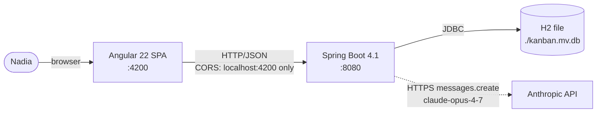

# Solution Design — Local AI-Augmented Kanban

A one-week portfolio build showing a working slice of modern full-stack engineering: Spring Boot 4.1 + Angular 22, one AI-powered feature, zero deployment theatre. Everything runs locally; the only remote dependency is one Anthropic API call per "break this idea into cards" action.

The companion `ARCHITECTURE-SPINE.md` carries the enforceable invariants (14 architecture decisions, data contracts, dependency rules). **This document carries the story** — the shape of the problem, the five calls that defined the solution, what was deliberately left out, and where the risks sit.

---

## 1. Context

**The product.** A desktop-web Kanban with three fixed columns (To Do, In Progress, Done) and one flagship feature: type an idea in natural language, Claude breaks it down into 4–6 actionable cards, review and accept them inline. Single user, single machine, no accounts, no cloud.

**Who it's for in real life.** Nadia — a developer with 2 YoE sitting at a café on a Saturday morning, staring at *"deploy my app to Fly.io"* in her notebook. She wants the blank-page-to-actionable-work gap closed in under ten seconds. The UX spine (`EXPERIENCE.md`) walks her 7-step journey end-to-end; this doc focuses on what the architecture does to make that moment reliable.

**Who it's for in the room.** A full-stack reviewer. The build is a portfolio artefact for Java / Angular interview conversations. The constraints follow from that: production-quality idiom choices, no over-engineering, visible discipline in what's left out.

**Budget.** 1 week, solo. Demo-day target: Thursday 2026-11-27.

---

## 2. Architecture at a glance



Two independently-runnable processes, one embedded file database next to the JAR, one outbound HTTPS call. That is the whole system envelope.

**Backend paradigm:** classic layered Spring MVC — `controller → service → repository`, DTOs across the HTTP boundary, one `@RestControllerAdvice` for errors, `@Transactional` only on service methods. (`AD-1`)

**Frontend paradigm:** standalone Angular 22 components with signals. A single `BoardStore` owns board state as a writable signal; components read via `computed()`, mutate via store method calls, and never touch `HttpClient` directly — only `ApiService` does. (`AD-9`)

**System boundary:** HTTP/JSON over localhost. No shared library. No shared contract generator. Both sides declare the `CardStatus` and `Priority` enums manually; the server is authoritative, the client mirrors. (`AD-3`)

---

## 3. The six calls that shaped this

### 3.1 — AI capability is runtime-probed, never compile-time flagged

**Chosen.** `@ConditionalOnProperty(name = "anthropic.api-key", matchIfMissing = false)` gates the whole AI bean graph — controller, service, `RestClient`. When the key is absent, `/api/ai/breakdown` returns 404 and the bean graph literally does not contain the AI code. A separate endpoint `GET /api/config` returns `{ aiEnabled, locales }`; the frontend reads that at bootstrap and decides whether to render the AI breakdown bar. (`AD-6`)

**Rejected.**
- *Build-time feature flag in Angular.* Would require two builds and leak Anthropic-ness into the frontend bundle.
- *Hardcoded `aiEnabled: true` with a graceful 503 fallback at call time.* Works in practice, but then the AI bar is always rendered and the user sees it fail — bad demo surface.

**Why it matters.** A reviewer running `git clone && ./mvnw spring-boot:run && npm start` with no `ANTHROPIC_API_KEY` set in their shell sees a working Kanban (manual add still works) with no AI bar and no error toasts. PRD **NFR-5** (clone + 2 commands → working app) holds whether the key is present or not — the single most visible test of the "zero-install" promise.

### 3.2 — AI output is validated twice; the UI never sees invalid cards

**Chosen.** The Anthropic call uses the Messages API's structured-output feature (`output_config.format = { type: "json_schema", schema: <cards>, ... }`) so the model is pushed to emit the right shape at the source. The service then runs a **second**, stricter Jackson-schema validator against the response before returning anything to the controller — the same contract the frontend expects, with the field-level rules (`title` 1..120, `description` 0..2000, `priority` enum, `cards` count 4..6). Any deviation — network failure, non-JSON, schema violation, wrong card count — throws `AiUnavailableException` and surfaces as HTTP `503 AI_UNAVAILABLE`. **Never a `200` with empty cards. Never a partial.** (`AD-5`)

**Rejected.**
- *Just trust the structured output.* Even with JSON mode, models sometimes return valid-shape-but-wrong-count arrays, or empty strings in required fields. The second validator costs ~30 lines and removes a whole class of UI parsing code.
- *Parse-and-repair in the frontend.* Puts LLM-specific logic in the UI, violates `AD-1` (entities / wire format) and makes the UI harder to reason about.

**Why it matters.** The flagship moment — modal opens with 5 draft cards — must never land as "modal opens with 2 cards, all empty." The two-layer validation makes the 503 path the *only* non-happy path: the toast is specific, the UI stays clean.

### 3.3 — Position is server-owned, server-renumbered, race-free

**Chosen.** The card `position` is a zero-indexed int unique within each `status`, enforced by a DB `UNIQUE(status, position)` constraint. On any membership-changing operation the server opens a transaction, takes `SELECT … FOR UPDATE` on the affected status partition, renumbers `0..n-1`, returns the authoritative list. The frontend replaces its local list with the response; it does not sort client-side. (`AD-4`)

**Rejected.**
- *Sparse integer gaps* (position = 100, 200, 300; inserts at 150). Smaller writes but adds a rebalance step and still breaks under adversarial reorder patterns.
- *Lexicographic string keys* (like Trello). Correct but overkill for 100 cards on a single-user board.
- *Client-authoritative ordering.* Would mean no `UNIQUE` constraint, position drift under rapid drag, and the frontend needing to understand position math.

**Why it matters.** Even in a single-user app, a user can fire two PATCHes within 50ms via rapid drag — concurrent transactions without a lock produce duplicate positions. The `UNIQUE` constraint makes that a server bug (observable in logs), not silent data corruption. For a reviewer running `axe` or opening the DB file to look at rows, this reads as "the author thought about the DB, not just the API."

### 3.4 — Optimistic frontend; atomic batch for AI accept

**Chosen.** Two update paths in the store, deliberately not merged. (`AD-8`)

- **Single-card mutations** (drag, inline edit, priority chip, delete): mutate the local signal immediately, fire `PATCH`/`DELETE`, roll back on non-2xx with a `Toast`. Feels instant; this is where `NFR-1` (<100ms drag latency) lives.
- **AI accept**: cards do **not** enter the board until `POST /api/cards/batch` returns 2xx. The batch is **all-or-nothing** — either every selected card persists and the server returns `201 Created` with the full array, or the whole thing rolls back and the modal stays open with an inline error. No `207 Multi-Status`, no server-side queued state between preview and accept.

**Rejected for batch accept.**
- *Partial success with `207`.* Would leave the board half-populated after a failure, which breaks the mental model ("I accepted 5 cards, I see 3, where are the other 2?"). Simpler to redo.
- *Optimistic batch insert with rollback.* Doable, but after a 5-second AI call plus a review-and-edit pause, the user expects *commit*, not *best-effort*. Atomic matches the mental model.

**Why it matters.** The two patterns cover every card interaction with no third strategy. A new story adding a card operation knows which path to pick from the shape of the interaction, not from a style guide.

### 3.5 — Containerization as the primary run path

**Chosen.** Two Dockerfiles (multistage each), one `docker-compose.yml`, launchers for every OS the reviewer might open the repo on. The containerized path is the **primary** entry for anyone cloning the repo; the two-process dev mode (`./mvnw spring-boot:run` + `npm start`) stays as the secondary path for hot reload during development. (`AD-15`)

- **Backend image.** `maven:3.9-eclipse-temurin-21` build stage → `eclipse-temurin:21-jre-alpine` runtime. <250 MB. Exposes 8080, env vars `ANTHROPIC_API_KEY` (optional per `AD-6`) and `SPRING_PROFILES_ACTIVE=container`. The `container` profile overrides `spring.datasource.url` to point at `/data/kanban.mv.db` inside a named Compose volume (`kanban-data`), so `docker compose down` preserves state.
- **Frontend image.** `node:22-alpine` build (`ng build --configuration production`) → `nginx:1.27-alpine` runtime. <50 MB. `nginx.conf` ships SPA fallback (`try_files $uri $uri/ /index.html`), gzip for text assets, immutable cache headers for hashed Angular bundles, and a reverse proxy `location /api { proxy_pass http://backend:8080/api; }` — which eliminates CORS entirely in containerized mode (same-origin from the browser's point of view). The CORS bean (`AD-12`) stays for dev mode but is a no-op in Compose.
- **Healthcheck + `depends_on`.** Backend exposes `/actuator/health` only (nothing else from the actuator). Compose waits for `service_healthy` before starting the frontend, so the demo never opens on a white screen because the API wasn't up yet.
- **Launchers.** `start-windows.ps1` is primary (checks Docker Desktop is running, warns if `.env` is missing but doesn't fail per `FR-25`, runs `docker compose up -d --build`, prints the URLs). `start.bat` is a thin wrapper invoking the `.ps1` with `-ExecutionPolicy Bypass` for double-click users who'd otherwise hit the Windows PowerShell policy wall. `start.sh` / `stop.sh` mirror the bash story for Mac/Linux reviewers. `stop-windows.ps1 --purge` is the only prompt-guarded path that destroys the `kanban-data` volume.

**Rejected / weighed.**
- *Distroless base image for the backend* (`gcr.io/distroless/java21`). Smaller attack surface, no shell. Rejected because debugging during the build week is harder and the size win over `-jre-alpine` is marginal for this project.
- *`serve` or shipping the Angular dev server in the container*. Rejected: nginx is production-idiom, carries the reverse proxy, and logs to stdout for free.
- *Bind mount for H2 instead of named volume*. Rejected: bind mounts leak a host-specific path into the repo and have poor WSL2 performance on Windows.
- *CI (GitHub Actions) in MVP*. Deferred. The containerized build is scripted locally; automation is the next natural step but doesn't ship this week.

**Why it matters — the senior-signal angle.** A reviewer who clones this repo sees three things in the README before installing anything: (1) prerequisites is "Docker Desktop" and nothing else; (2) the two commands to run are a double-click or a one-liner; (3) data survives a stop/start. This is the shape of a senior Java/Angular submission — not "here's the code, now install Java 21 and Node 22 and read my setup notes."

### 3.6 — `ddl-auto=update` instead of Flyway, on purpose

**Chosen.** Hibernate's schema-update mode generates and runs DDL from the `@Entity` classes at startup. No migration files, no migration tooling. (`FR-21`, `AD-14`)

**Rejected.**
- *Flyway / Liquibase*. Industry standard for migrations. Adds a migrations folder, a versioning discipline, a failure mode where the migration log and the schema disagree. For a 1-week MVP with one entity and no production target, this is cost without benefit.

**Why it matters — and when this changes.** `ddl-auto=update` is the right call when: single entity, no production, no schema evolution planned. It becomes the wrong call the first time two developers work on the same schema in parallel branches, or the first time a column needs to be *dropped*. The spine's `Deferred` section names exactly when to swap it out: *"First time the schema needs a non-trivial transform, swap in Flyway and migrate the Card table."* In interview conversation, this is the shape of the answer a reviewer wants to hear: "I know why I picked the simpler tool, and I know what makes it the wrong tool later."

---

## 4. How the non-functional targets are met

| NFR | Target | How |
|---|---|---|
| NFR-1 | Drag latency < 100 ms perceived | Optimistic FE update in `BoardStore` (`AD-8`); server returns in one DB tx (`AD-4`). Perceived latency is dominated by local signal update, not round-trip. |
| NFR-2 | AI breakdown p95 < 10 s | `RestClient` with 10s connect / 30s read timeout (no retry — one-shot, fail fast). Structured output short-circuits the "model returned chatty JSON" failure mode. (`AD-5`) |
| NFR-3 | Backend cold start < 10 s | Embedded H2 (no external DB wait), Spring Boot 4.1 defaults, no heavy auto-config. |
| NFR-4 | Frontend cold load < 2 s | Standalone components + signals (no `NgModule` tree-shake tax), system font stack (no web-font fetch), no polyfills beyond Angular's defaults. |
| NFR-5 | Clone + 2 commands → working app | `./mvnw spring-boot:run` + `npm start`. `ANTHROPIC_API_KEY` is optional (`AD-6`). |
| NFR-6 | No data leaves machine except the AI call | H2 is a local file, no telemetry, no analytics, CORS locked to `http://localhost:4200`. (`AD-12`) |
| NFR-7 | Minimal test shape | Three layers: parser/validator units, `@WebMvcTest` per controller, one `@SpringBootTest` boot→write→restart→read integration. No E2E. (`AD-11`) |
| NFR-8 | Idiomatic layout, no dead code | Classic Spring packages (`controller`/`service`/`repository`/`dto`/`mapper`), Angular standalone + signals, no starter boilerplate kept. |
| NFR-9 | Keyboard nav + semantic HTML + focus trap | Covered in `EXPERIENCE.md`'s Accessibility Floor (ARIA on modal, `cdk/drag-drop` keyboard support, columns as `<section aria-labelledby><h2>`, focus trap via `MatDialog`-style primitives). |

---

## 5. Risks and mitigations

| Risk | Likelihood (over 1 week) | Mitigation |
|---|---|---|
| Anthropic rate limit or model deprecation during demo week | Low — single user, structured-output API is GA | Fallback path is the `AI_UNAVAILABLE` toast + manual card creation. `AD-6` means demo still works without the key. |
| H2 file corruption on hard shutdown | Low — H2 has journaling, single-writer | Integration test covers restart-persistence (`NFR-7`). If it ever happens: delete `kanban.mv.db`, restart, continue. |
| Position renumber bug under rapid drag | Low after `AD-4` hardening | `UNIQUE(status, position)` makes it a loud server bug, not silent corruption. |
| Angular 22 / Spring Boot 4.1 are both <6 months old; learning-curve risk | Medium | Both have GA release notes and migration guides; the architecture is paradigm-stable (nothing in the spine is version-specific except the stack table). Downgrade path is one minor on each. |
| Scope creep: adding auth / multi-user "just a little" | Medium — tempting in interview conversation | PRD and spine both document this as a hard non-goal (`AD-14` has no user field). Adding it is a new spine, not an amendment. |
| Demo-day stage fright (the 4–7s Anthropic wait feels like forever live) | Medium | The "Thinking…" status line + `aria-busy` + spinner cover the gap (EXPERIENCE.md `Loading (AI)`); demo script fills the pause with a one-liner. |
| Docker Desktop not running when reviewer launches `start.bat` | Medium | `start-windows.ps1` detects the daemon is down, prints a one-line fix with a link, exits cleanly rather than throwing a wall of `docker` errors. |
| `kanban-data` volume accidentally destroyed on `stop --purge` | Low | The `--purge` flag is interactive-only; the stop script prompts for Y/N before removing the volume. The plain `stop-windows.ps1` and `stop.sh` are non-destructive. |

---

## 6. What's out of scope, and the forward posture for each

This is the half of the design that matters most for an interview conversation: the discipline of what was left out.

| Deferred | Current posture | When to re-open |
|---|---|---|
| **Authentication & multi-user** | None. Any `Authorization` header is ignored. | When more than one person needs to use the same board. |
| **CI (GitHub Actions / similar)** | Containerized build is scripted locally (`AD-15`). | When commits land from more than one branch and a reviewer wants to see green before pulling — GitHub Actions running `docker compose build` + the test layers from `AD-11` is the next natural step. |
| **Cloud deploy / registry push** | Local only; images tagged `:dev`, not pushed anywhere. | When the product moves off a laptop. Fly.io with the backend image + a managed Postgres is the obvious next hop; the frontend image can go to any static host. |
| **DB migrations (Flyway)** | `ddl-auto=update`. | First time the schema needs a non-trivial transform — add a column with a backfill, rename, drop. |
| **AI retry / circuit breaker / streaming** | Single-shot, fail-fast, 30s read timeout. | When the demo bar lifts and reliability matters more than momentum. Resilience4j is the standard next step. |
| **Observability (metrics, tracing, request-id)** | SLF4J logs only. | When the app runs anywhere other than this laptop. Micrometer + OTEL is the standard next step. |
| **Rate limiting on `/api/ai/breakdown`** | None. `FR-16` handles single-flight client-side. | When the service becomes shared (multi-user) — Bucket4j or Spring Cloud Gateway. |
| **E2E tests (Playwright)** | None. `NFR-7` bounds testing to three layers. | When the critical flow becomes regression-prone, or when the UX changes faster than manual QA can catch. |
| **Responsive / mobile layout** | Documented forward posture in `EXPERIENCE.md`; no code change for MVP. | When mobile use is a real user story, not a demo nicety. |
| **Multi-locale beyond FR/EN** | Locale enum and `/api/config.locales` are the extension point. | When a third locale is needed — add to the enum, add a JSON file, done. |

---

## 7. Tree-level view

```text
kanban-bmad/
  docker-compose.yml             # AD-15 orchestrator — backend + frontend + kanban-data volume
  .env.example                   # ANTHROPIC_API_KEY placeholder (.env is gitignored)
  .gitignore
  start-windows.ps1              # primary Windows launcher — up -d --build, prints URLs
  stop-windows.ps1               # primary Windows stopper — down; --purge removes volume
  start.bat / stop.bat           # thin wrappers invoking the .ps1 with -ExecutionPolicy Bypass
  start.sh / stop.sh             # bash equivalents for Mac/Linux reviewers
  README.md                      # NFR-5: prerequisites Docker Desktop only
  backend/
    Dockerfile                   # multistage: maven:3.9-eclipse-temurin-21 -> eclipse-temurin:21-jre-alpine
    pom.xml                      # Spring Boot 4.1, Java 21, starter-restclient, starter-actuator
    src/main/java/com/marwen/kanban/
      KanbanApplication.java
      config/                    # CorsConfig (dev mode), AnthropicRestClientConfig (@ConditionalOnProperty)
      controller/                # CardController, AiBreakdownController, ConfigController
      service/                   # CardService, AiBreakdownService, AiBreakdownValidator
      repository/                # CardRepository (Spring Data JpaRepository)
      mapper/                    # CardMapper (DTO <-> entity)
      dto/                       # CardDto, CreateCardRequest, PatchCardRequest (JsonNullable),
                                 # BreakdownRequest, BreakdownResponse, ErrorResponse
      domain/                    # Card (entity), CardStatus, Priority
      exception/                 # AiUnavailableException, GlobalExceptionHandler
    src/main/resources/
      application.yml            # default profile: datasource ./kanban.mv.db next to jar (dev mode)
      application-container.yml  # container profile: datasource /data/kanban.mv.db (named volume)
    src/test/java/com/marwen/kanban/
      service/                   # AiBreakdownValidatorTest, CardServiceTest
      controller/                # @WebMvcTest per controller
      integration/               # BootRestartPersistenceTest
  frontend/
    Dockerfile                   # multistage: node:22-alpine build -> nginx:1.27-alpine runtime
    nginx.conf                   # SPA fallback + /api reverse proxy + gzip + immutable cache
    angular.json                 # Angular 22
    src/app/
      app.config.ts              # bootstrapApplication, ngx-translate, routes
      features/board/            # board, column, card, ai-breakdown-bar, preview-modal, toast
      core/
        board.store.ts           # AD-9 state owner
        api.service.ts           # AD-9 HTTP surface
        models/                  # Card, CardStatus, Priority, Breakdown types
      shared/                    # icon-button, segmented-control, checkbox-wrap primitives
      styles/
        tokens.css               # DESIGN.md tokens on :root + :root[data-theme=dark]
    src/assets/i18n/
      en.json
      fr.json
```

---

## 8. Reading order for the reviewer

| If you have | Read |
|---|---|
| **60 seconds** (README skim) | Project `README.md` — the "what + run" block. |
| **5 minutes** (demo prep) | This solution-design doc, sections 1–3. |
| **15 minutes** (deeper look) | This doc in full + the spine's **Invariants & Rules** section. |
| **30 minutes** (code conversation) | All of the above + the spine's **Capability → Architecture Map** + walk one feature end-to-end in the code. |

---

## Appendix — document map

- **`ARCHITECTURE-SPINE.md`** — the enforceable invariants (14 ADs, conventions, stack, structural seed, capability map). Build substrate.
- **`.memlog.md`** — append-only decision log. Rationale lives here, not in the spine.
- **`review-rubric.md`** — pre-handoff structural review.
- **`review-versions.md`** — stack versions verified against upstream 2026-11-20.
- **`review-adversarial.md`** — attack-the-spine review (12 attack pairs, 11 uncovered dimensions).
- **Upstream sources** — `../prds/prd-kanban-bmad-2026-11-20/prd.md`, `../briefs/brief-kanban-bmad-2026-11-20/brief.md` (+ addendum), `../ux-designs/ux-kanban-bmad-2026-11-20/DESIGN.md` + `EXPERIENCE.md`.
